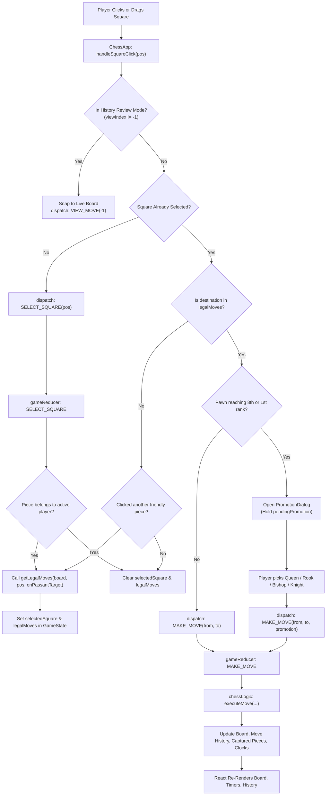
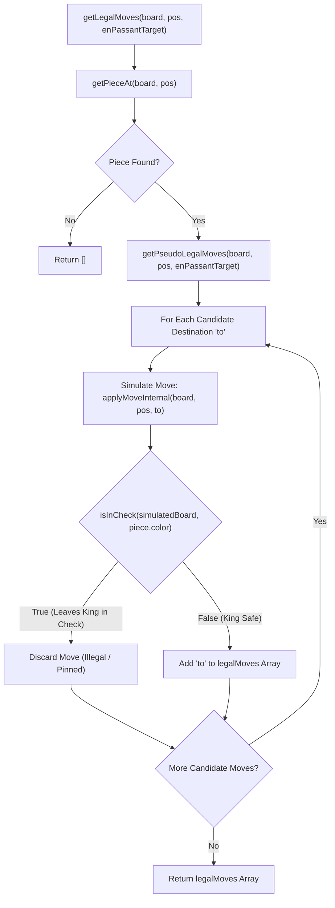

# ♟️ Chess.com Clone — Local Two-Player Chess

A modern, responsive, and fully featured local two-player chess web application built with **React 19**, **TypeScript**, **Vite**, and **Tailwind CSS**. Designed to replicate the authentic look, feel, and competitive mechanics of [Chess.com](https://www.chess.com).

---

## ✨ Features

### 🎮 Authentic Chess.com Look & Feel
- **Classic Board Theme**: Exact green and cream palette (`#739552` dark squares, `#ebecd0` light squares) with subtle edge coordinates.
- **Move Indicators**: Translucent center dots for empty legal squares and perimeter rings for capturable enemy pieces.
- **Visual Feedback**: Soft yellow tints for selected pieces and last move (`from` and `to`), plus an animated crimson alert when a King is in check.
- **Dual Input Modes**: Full support for both **Click-to-Move** and HTML5 **Drag-and-Drop**.
- **Board Orientation**: Instant board flipping (<kbd>F</kbd> key or button) to alternate perspectives between Black and White.

### 🧠 Complete Chess Engine Logic
Strict implementation of official FIDE chess rules with zero external chess library dependencies:
- **Piece Movements**: Authentic movement mechanics for Pawns, Knights, Bishops, Rooks, Queens, and Kings.
- **Absolute Pins & King Safety**: Move candidates are simulated on a virtual board; any move that leaves or places the King in check is rejected.
- **Castling**: Both Kingside (`O-O`) and Queenside (`O-O-O`) castling with complete rule verification:
  - King and target Rook have not previously moved.
  - Intervening squares are unoccupied.
  - King is not currently in check.
  - King does not transit through or land on attacked squares.
- **En Passant**: Accurately tracked and capture window enforced strictly on the immediately following move.
- **Pawn Promotion**: Interactive modal offering Queen, Rook, Bishop, or Knight when a pawn reaches the 8th (White) or 1st (Black) rank.
- **Game-Over Detection**:
  - **Checkmate**: Zero legal moves while King is in check.
  - **Stalemate**: Zero legal moves while King is *not* in check.
  - **Insufficient Material**: Automatic draws for $K$ vs $K$, $K+B$ vs $K$, $K+N$ vs $K$, and same-colored bishop endgames.
  - **Timeout**: Automatic flag-fall loss when a player's clock reaches `0:00`.
- **Standard Algebraic Notation (SAN)**: Real-time notation generator supporting captures (`x`), promotions (`=Q`), checks (`+`), checkmates (`#`), and piece disambiguation (e.g. `Nbd7` or `R1e2`).

### ⏱️ Digital Tournament Clocks & Player Strips
- **Card-Style Player Consoles**: Avatars, player names, rating badges (`1500`), and live captured pieces grouped with count multipliers.
- **Material Advantage Badge**: Real-time evaluation pill displaying material difference (e.g., `+1`, `+3`).
- **Configurable Time Controls**:
  - **10 min** (Rapid)
  - **5 min** (Blitz)
  - **3 min** (Blitz)
  - **1 min** (Bullet)
  - **∞** (Untimed casual play)
- **Clock Highlights**: High-contrast active turn indicator (`bg-white text-black`) with flashing red emergency warning when under 30 seconds.

### 📜 Interactive Move History & Review
- **Two-Column SAN Table**: Auto-scrolling notation table formatted by turn number (`1. e4 e5`).
- **Position Scrubbing**: Click any past move or use the toolbar buttons (`|<`, `<`, `>`, `>|`) to review previous board states without disrupting the live game.
- **Live Board Snap**: Click the board or press <kbd>Esc</kbd> / <kbd>↓</kbd> to immediately resume the live position.

---

## 📊 System Architecture & Logic Flow

GitHub natively renders the Mermaid diagrams below. For granular function diagrams (such as attack scans, SAN disambiguation, and castling checks), see [docs/FLOWCHARTS.md](./docs/FLOWCHARTS.md).

### 1. User Interaction & Move Flow


### 2. Legal Move Generation & King Safety Pipeline


---

## ⌨️ Keyboard Shortcuts

| Key | Action |
| :--- | :--- |
| <kbd>U</kbd> | **Undo / Takeback**: Revert the last move |
| <kbd>F</kbd> | **Flip Board**: Rotate board perspective 180° |
| <kbd>R</kbd> | **New Game**: Reset to initial board position |
| <kbd>←</kbd> | **Step Backward**: View previous move in history |
| <kbd>→</kbd> | **Step Forward**: View next move in history |
| <kbd>Esc</kbd> / <kbd>↓</kbd> | **Live Board**: Return from review mode to the live match |

---

## 📁 Project Structure

```
Chess/
├── docs/
│   └── FLOWCHARTS.md         # Detailed GitHub-native Mermaid flowcharts
├── public/
│   ├── assets/
│   │   └── pieces/
│   │       ├── black/        # PNG piece assets (pawn, knight, bishop, rook, queen, king)
│   │       └── white/        # PNG piece assets (pawn, knight, bishop, rook, queen, king)
│   └── favicon.svg
├── src/
│   ├── components/
│   │   ├── Board.tsx         # 8x8 grid container, drag-and-drop & square mapping
│   │   ├── Square.tsx        # Square rendering, highlights, coordinates, indicators
│   │   ├── Piece.tsx         # Crisp draggable piece rendering
│   │   ├── MoveHistory.tsx   # SAN table & history navigation toolbar (|< < > >|)
│   │   ├── PromotionDialog.tsx # Pawn promotion picker modal
│   │   └── ChessApp.tsx      # Main layout, timer intervals, keyboards, player strips
│   ├── store/
│   │   └── game-state.ts     # useReducer store, actions, history replay, clock logic
│   ├── types/
│   │   └── chess.ts          # Core domain types (Board, Piece, Move, GameState, etc.)
│   ├── utils/
│   │   ├── chessLogic.ts     # Pure chess engine: move generator, check detection, SAN
│   │   └── constants/
│   │       └── board.ts      # Starting layout and coordinate helpers
│   ├── App.tsx               # App root
│   ├── index.css             # Tailwind v4 configuration and custom scrollbars
│   └── main.tsx              # React DOM bootstrap
├── index.html                # HTML entry point with metadata
├── package.json              # Project dependencies and npm scripts
├── tsconfig.json             # TypeScript configuration
└── vite.config.ts            # Vite & Tailwind CSS plugins
```

---

## 🚀 Getting Started

### Prerequisites
- [Node.js](https://nodejs.org/) (version 18.0.0 or higher)
- [npm](https://www.npmjs.com/) (version 9.0.0 or higher)

### Installation
1. Clone the repository:
   ```bash
   git clone https://github.com/your-username/chess.git
   cd chess
   ```

2. Install dependencies:
   ```bash
   npm install
   ```

3. Start the development server:
   ```bash
   npm run dev
   ```

4. Open your browser and navigate to:
   ```
   http://localhost:5173
   ```

---

## 🛠️ Available Scripts

- **`npm run dev`**: Starts the Vite local development server with Hot Module Replacement (HMR).
- **`npm run build`**: Runs TypeScript type checking (`tsc -b`) and bundles production assets with Vite into `dist/`.
- **`npm run preview`**: Serves the production build locally for testing.
- **`npm run lint`**: Lints codebase with ESLint.

---

## 🎨 Tech Stack

- **Framework**: [React 19](https://react.dev/)
- **Language**: [TypeScript 5](https://www.typescriptlang.org/)
- **Bundler**: [Vite 8](https://vitejs.dev/)
- **Styling**: [Tailwind CSS v4](https://tailwindcss.com/)
- **Diagrams**: GitHub-Native [Mermaid.js](https://mermaid.js.org/)

---

## 📄 License

This project is licensed under the [MIT License](LICENSE). Feel free to use, modify, and distribute it for personal or educational projects.
