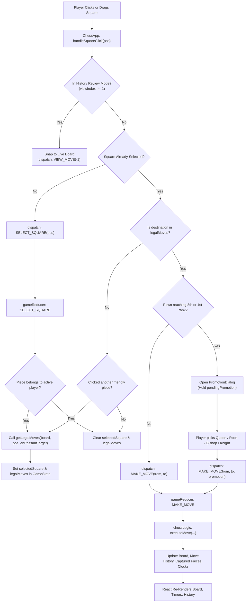
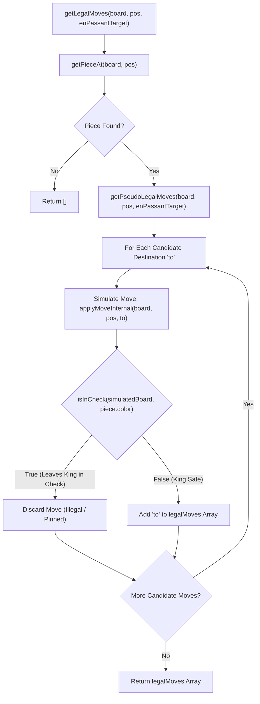
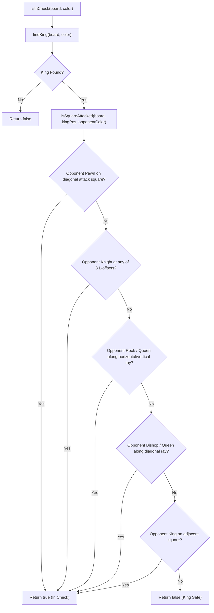
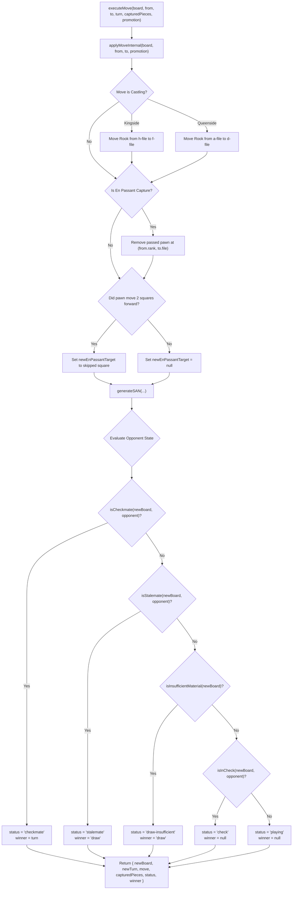
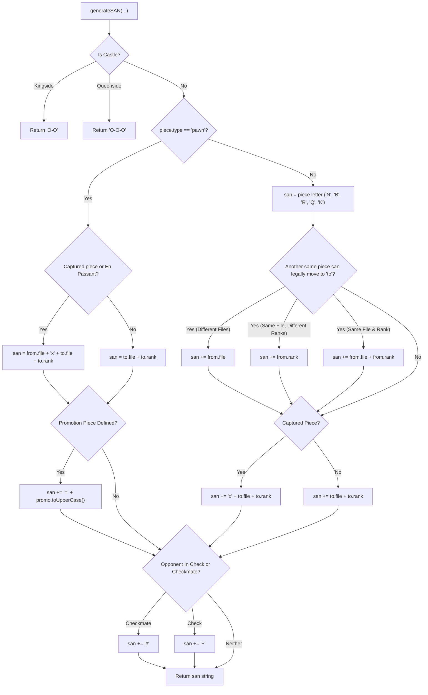
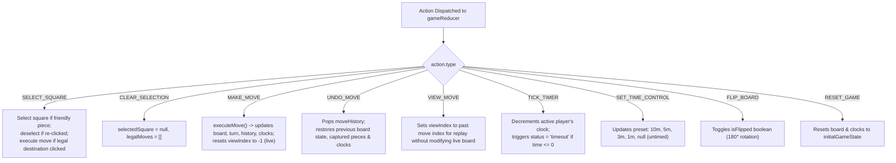

# ♟️ Chess App — Complete Logic & Data Flowcharts

This document details the data structures, state lifecycles, and function algorithms powering the Chess application using **GitHub-native Mermaid diagrams**.

---

## 1. End-to-End User Interaction & Move Flow

The lifecycle of a single move from player interaction to board re-render:

---

## 2. Legal Move Generation Pipeline (`getLegalMoves`)

A candidate move is only strictly legal if making it does not leave the moving player's King in check (enforces absolute pins and King escape requirements).

---

## 3. Attack Detection & Check Logic (`isInCheck` & `isSquareAttacked`)

Determines whether a square (specifically the King's position) is under attack by any opposing piece:

---

## 4. Atomic Move Execution (`executeMove`)

Applies moves, shifts castling rooks, removes en-passant captured pawns, generates notation, and evaluates game-over states:

---

## 5. Algebraic Notation Generation (`generateSAN`)

Generates Standard Algebraic Notation according to FIDE standards:

---

## 6. Reducer State Machine Lifecycle (`gameReducer`)

